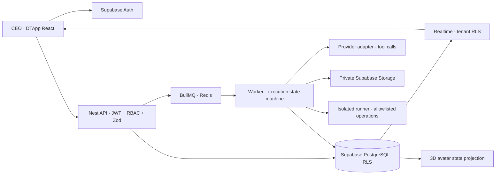

# AI Virtual Office — kiến trúc mở rộng DTApp

Ngày audit: 2026-10-23. Trạng thái nghiệm thu chi tiết: `docs/office/VALIDATION.md`.

## Quyết định nền tảng

DTApp hiện tại không phải fork Claude-Office: React 19, Vite 7, Express 5 cho xử lý ảnh, Supabase Auth/Postgres/Storage, Electron 45. Giữ các tính năng poster, bio, Google login, quyền app và bản desktop. Module Văn phòng AI được tải riêng; API NestJS và worker chạy riêng với API ảnh hiện tại. Không ghi đè lịch sử/migrations của DTApp.

Nguồn tham chiếu đã clone tại `.upstream/Claude-Office` (Git bỏ qua), commit `1a9ba71251326b34c3caa90d49468e75420d0dd4`, phiên bản 1.1.1. Audit đọc README, reference, package, LICENSE, NOTICE, server, hooks, reducer, character, chat, task board và tests. Repo upstream vẫn nguyên vẹn; không cài hooks vào máy người dùng.

## Mapping cũ → mới

| Thành phần Claude-Office | Bằng chứng mã | Hướng kế thừa |
|---|---|---|
| React 18/Vite 5 | package.json, src/App.tsx | DTApp đã React 19/Vite 7; thêm module lazy load |
| Express/ws, event snapshots, reconnect | server/index.js, src/hooks/useAgentSocket.ts | Nest REST, Supabase Realtime cho dữ liệu bền vững; snapshot/refetch khi reconnect |
| Claude Code hooks/status line | hooks/agent-tracker.sh, status-line.sh, hooks.json | Giữ nguyên tham chiếu; adapter nhập sự kiện có xác thực cần giai đoạn riêng |
| officeReducer thuần, effects tách khỏi React | src/officeReducer.ts | Kế thừa nguyên tắc event → state; trạng thái công việc lấy từ agent_runs/tool_calls, không random |
| Pixel characters, movement, day/night | Character.tsx, agentManager.ts, daylight.ts | Góc nhìn 3D R3F riêng, bảo tồn nguồn 2D; không chuyển ảnh thành nền giả 3D |
| SQLite messages, threads, reactions, recipient | server/chat-db.js | conversations/agent_messages PostgreSQL; UUID và legacy_id có namespace |
| Claude CLI chat watcher, định tuyến bằng từ khóa | scripts/, server/index.js | Provider adapter có tool calling; job durable và giới hạn; không xem reply là bằng chứng thực thi |
| In-memory agents/sessions, agents.json | server/sessions.js, status.js | agents, agent_sessions, agent_runs, agent_events theo tổ chức |
| File-based task board | server/tasks.js, src/taskBoard.ts | tasks/task_dependencies PostgreSQL; ràng buộc DAG và tenant |
| Permission long-poll/token local | server/permissions.js | approval gắn đúng run/tool/input, chỉ CEO quyết định |
| Usage estimates | server/meterEstimate.js, src/meters.ts | Provider usage thực + đơn giá cấu hình, reservation ngân sách nguyên tử |
| Electron tự bật server local, tray/widget | electron/main.cjs, helpers.cjs | Giữ Electron DTApp; module web dùng API riêng. Tray/widget upstream chưa port |
| Vitest (README nói 972 tests) | tests/*, vitest.config.ts | Chạy test thực tế trước khi báo số lượng; không coi con số README là test đã chạy |

Upstream có `?sim`, random events và câu thoại dựng sẵn. Các cơ chế này không được dùng để biểu thị công việc thật. Task thành công, test PASS và deployment thành công phải có kết quả công cụ được lưu.

## Luồng dữ liệu

PostgreSQL là nguồn dữ liệu chính. Redis chỉ là cơ chế đánh thức worker; job phải có run record trước khi enqueue. Không retry tự động thao tác có tác dụng ngoài nếu chưa xác định idempotency. Checkpoint sau mỗi bước; claim và reservation dưới khóa database. API người dùng dùng JWT của chính người dùng để giữ RLS. Chỉ worker/migration có server credential.

## Mô hình dữ liệu và bảo mật

32 bảng trong migration bổ sung dùng tên yêu cầu, UUID, timestamps, FK và index. Mọi quan hệ cùng tenant dùng FK tổng hợp `(organization_id, id)`; quan hệ task còn giới hạn cùng project. RLS: thành viên đọc, CEO/manager sửa cấu hình, agent/worker ghi execution. Không cho browser sửa usage/events hoặc tự duyệt approval. CEO luôn là người dùng Auth, không tạo agent CEO. Tổ chức khởi tạo bằng RPC nguyên tử; không tự mở quyền quản trị toàn hệ thống.

Server key và provider key chỉ lấy từ môi trường process, không có `VITE_*` secret. Model provider record chỉ chứa tên biến môi trường và metadata, không chứa key. Tool có schema, allowlist, quyền theo agent, hạn mức và approval khi cần. Tài liệu/repo/tool output là dữ liệu không tin cậy; không được thay đổi policy bằng prompt. Không chấp nhận endpoint tùy ý từ model; không chạy shell trên API host. Logs không ghi bearer token/provider key.

Budget USD dùng numeric/đơn vị nguyên khi tính; không dùng float để cộng tiền. Reserve mức tối đa mỗi model call dưới row lock; settlement lưu usage do provider trả về. Timeout mất usage phải giữ reservation để tránh báo thiếu chi phí. Không tự đặt giá model là 0.

## Điều phối đích và ranh giới nghiệm thu

PM → BA → CEO duyệt scope → PM tạo DAG → Developer → Tester → vòng sửa có giới hạn → PM review → CEO duyệt deployment → runner deploy → báo cáo. Chạy đồng thời chỉ các node đủ dependency; pause/cancel kiểm tra giữa bước và hủy request đang chạy. Resume không được phát lại tool thành công. Deployment và GitHub write cần adapter, quyền cụ thể và approval. Tính năng chưa có adapter/credentials phải trả về chưa cấu hình, không giả kết quả.

## 3D và frontend

Zustand chỉ lưu lựa chọn UI; TanStack Query quản lý server state. Canvas tải lazy, OrbitControls xoay/zoom/pan, camera isometric/perspective, ánh sáng ngày/đêm. Animation frame chỉ sửa Three refs/mixer. GLTF loader cache asset đã phê duyệt license; khi chưa có nhân vật GLB, dùng mesh hình học và ghi rõ trạng thái thay thế. Mobile có danh sách tương đương và nút bật 3D. Không dựng nhân viên hoặc tiến độ mẫu trong môi trường thật.

## Giấy phép và bảo tồn

Claude-Office code/default pixel art: MIT, copyright 2026 W17ANT; sao chép LICENSE/NOTICE khi tái sử dụng. Skin Dunder Mifflin, nhân vật/props từ chương trình The Office và trích dẫn `theme.ts` bị loại khỏi MIT theo NOTICE.md. Không phân phối các tài sản đó. 3D assets phải có manifest nguồn/license riêng. DTApp vẫn giữ license hiện tại; upstream MIT không tự cấp quyền cho tài sản bên thứ ba.

## Vận hành

Docker Compose: web, API, worker, Redis, runner cách ly; Supabase Cloud bên ngoài. Runner không được mount Docker socket, repo host hay secrets provider; network nội bộ bị hạn chế, non-root, read-only root, CPU/RAM/PID/time/output limits. Proxmox chạy Linux VM, reverse proxy HTTPS. Backup schema/data bằng pg_dump theo lịch, Storage backup riêng; restore vào project staging và chạy RLS/smoke trước khi đổi production.
