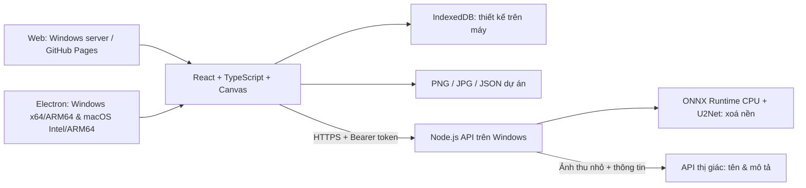

# Kiến trúc DT Poster Studio

## Một bộ mã giao diện, nhiều nơi chạy

`src/renderer.ts` là bộ dựng poster dùng chung giữa preview, thumbnail và xuất ảnh, tránh xuất ảnh bị khác bố cục so với màn hình. Canvas sử dụng font đóng gói, không phụ thuộc Google Fonts/CDN. Các mẫu được khai báo trong `src/model.ts`; renderer thay bố cục theo khổ dọc/ngang.

`server/background.mjs` chuẩn hoá RGB theo U²-Net, suy luận ở 320×320, phóng mask về ảnh tối đa 2400px, nhân với alpha gốc rồi cắt vùng thừa. Model chạy CPU; chi tiết tóc, kính trong suốt, vật thể nhỏ hoặc nền phức tạp có thể chưa tốt. Có thể nâng sang model lớn hoặc dịch vụ chuyên dụng bằng cách thay module server mà không đổi client.

`server/app.mjs` cung cấp:

| Route | Hành vi |
| --- | --- |
| GET `/api/health` | Trạng thái server, model, khả năng gợi ý đã cấu hình |
| POST `/api/remove-background` | Nhận `{ image: dataURL }`; trả PNG alpha và kích thước |
| POST `/api/suggestions` | Nhận ảnh, tên, nhóm, mô tả; trả ba tên và ba mô tả |

Không tự thay tên người dùng đã nhập khi nhận gợi ý AI. Nếu tên trống và AI trả kết quả, áp dụng gợi ý đầu; các gợi ý còn lại đều có thể bấm chọn. Không tự bịa thành phần, công dụng, giá hay thông số từ ảnh.

## Dữ liệu và khóa

Thiết kế và ảnh nằm trong IndexedDB của browser/profile desktop, có bản nháp tự lưu. Tệp JSON dự án chứa ảnh nên có thể lớn; người dùng có thể chuyển máy bằng xuất/nhập. Chưa có đồng bộ giữa các thiết bị. Mã truy cập server lưu sessionStorage; địa chỉ server và bộ thương hiệu lưu localStorage. Khóa nhà cung cấp AI chỉ nằm trong biến môi trường server.

## Các bước tiếp theo cho bản thương mại

1. Chọn thương hiệu chính thức, thư viện mẫu và quy tắc nội dung theo ngành hàng.
2. Chốt máy chủ, tên miền, nhà cung cấp AI và hạn mức chi phí, đo chất lượng xoá nền với ảnh thật.
3. Bổ sung đăng nhập, quota theo tài khoản, hàng đợi tác vụ, đồng bộ dự án nếu cần nhiều người dùng.
4. Thêm chỉnh text/layer tự do, lưu bộ font, logo, template tùy chỉnh và xuất hàng loạt nếu thuộc phạm vi sản phẩm.
5. Ký số Windows, notarize macOS, xác thực trên đủ bốn nền tảng vật lý, cấu hình phát hành/cập nhật.
